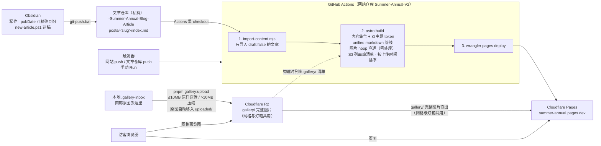

# 网站架构

## 图例说明

- **文章仓库（私有）**：只存文章源文件（md + 图片引用），不含任何站点代码。
  Front matter 的 `pubDate` / `updatedDate` 支持精确到分；**不要写时区后缀**，
  不带时区的值所见即所得。Obsidian 里把属性类型设为 **Date & time** 后
  "Today" 按钮才带时间栏。
- **网站仓库（公开）**：Astro 7 + Tailwind CSS 4（CSS-first，token 在
  `styles/tokens.css`，元素默认样式收在 `@layer base`）+ 构建流水线；
  构建产物（含文章内容）只存在 dist/，不进仓库。`.node-version` 锁定
  本地/CI 使用的 Node 版本。
- **R2（图床）**：`gallery/` 存完整图片（网格与灯箱共用同一份）。
  ≤10MB 原样直传（零损失），>10MB 最小损失压缩到 10MB 内（保持原始
  尺寸，先降质量）。读操作公开；写操作仅凭据（本地 `.env` 需要
  Object Read & Write 的 Token，CI 只需 Object Read）。
- **画廊排序**：按 R2 对象的上传时间（LastModified）降序，新的在前；
  同批内按文件名升序处理，因此批内文件名大者排前。重传旧图即置顶。
- **`pnpm gallery:upload`**：处理+上传二合一脚本（`scripts/gallery-upload.mjs`）。
  不带参数时使用文章仓库旁的 `.gallery-inbox/`（不存在自动创建）；
  上传成功的原图自动移入其 `uploaded/` 子文件夹；`--dry-run` 只算体积。
- **触发器**：三条路都会触发完整构建——网站 push、文章仓库 push
  （notify-site.yml 发 repository_dispatch）、Actions 手动。
- **本地开发**：`pnpm dev` 读取 `.env` 里的 R2 凭据，与线上同一套构建逻辑，
  `localhost:4321` 全功能预览。
